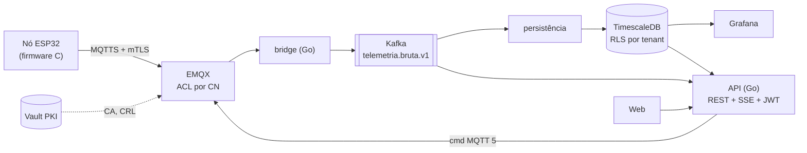

# garden-iot


Plataforma IoT de cuidado de plantas e hortas: nós ESP32 medem solo, ar e luz, a nuvem calcula a necessidade de água e comanda válvulas com regras de segurança, sempre com o humano no controle das ações físicas.

## Problema

Hortas domésticas e pequenos produtores regam no "olhômetro": água demais ou de menos, rega com vento forte ou com chuva a caminho, praga percebida tarde. Sensores baratos existem, mas os dados raramente viram decisões automáticas e seguras. O garden-iot coleta a telemetria, mede o que a planta precisa (evapotranspiração FAO-56 corrigida pelo sensor de solo), aciona atuadores com confirmação do dispositivo e alerta quando algo foge do esperado.

## Estado atual (marco M1, telemetria simulada)

| Área | Situação |
| --- | --- |
| Contrato `telemetria.bruta.v1` (Protobuf, `buf breaking` no CI) | pronto |
| Ambiente local (Vault, EMQX, Kafka, Schema Registry, TimescaleDB, Grafana) | pronto |
| PKI de dispositivos, EMQX com mTLS e ACL por nó e por serviço | pronto |
| Schema TimescaleDB com RLS por tenant, painel Grafana "Telemetria" | pronto |
| Firmware do nó sensor, `DevicePayloadTranslator` | branch `feat/firmware` |
| Bridge MQTT para Kafka, simulador de frota | branch `feat/bridge` |
| API REST e SSE (`services/api`) | em andamento |
| Irrigação (ET₀, balanço hídrico, saga), comandos, IA | M2 a M5, ver design doc |

## Interface

Front-end em `web/` (Vue 3, Vuetify 3, TanStack Query, zod), identidade "Cota": a horta como planta baixa, com cada canteiro preenchido pelo nível de umidade, hachura no déficit até a faixa ideal e símbolo de válvula com traço de fluxo na rega em curso. Telas: mapa da horta, detalhe do canteiro, regas e comandos (desejado × reportado) e dispositivos.

- `make api` em um terminal e `make web-dev` em outro (Vite em http://localhost:5173, `/api` vai para a API em :8090). O login pede um token: `make token TENANT=demo ROLE=operator`.
- No compose, o serviço `web` (profile `core`) serve o build por nginx em http://localhost:8088 e repassa `/api` para `WEB_API_UPSTREAM` (padrão: a API no host).
- Limite conhecido: o balanço mostrado é o observado (umidade medida e rega aplicada); o balanço FAO-56 depende de o planejador de irrigação persistir o déficit.

## Arquitetura



Detalhes e fluxos: [design doc](docs/design-doc.md).

## Layout

| Diretório | Conteúdo |
| --- | --- |
| `firmware/` | ESP-IDF em C, nó sensor e atuador |
| `services/bridge` | Go, MQTT para Kafka |
| `services/api` | Go, REST, SSE e comandos |
| `services/irrigation` | Go, balanço hídrico e saga (a partir do M2) |
| `services/assistant` | LangGraph (depois) |
| `tools/fleet-sim` | simulador de frota em Go |
| `contracts/` | Protobuf (`buf`), contrato MQTT e OpenAPI |
| `infra/` | EMQX, Vault, Kafka, TimescaleDB, Grafana |
| `web/` | front-end (depois) |

## Como rodar

Requisitos: Docker com Compose v2, Go 1.23, `make`, `openssl`. Para os contratos: `buf` e `protoc-gen-go`.

```bash
cp .env.example .env     # valores de desenvolvimento
make up                  # Vault, EMQX, Kafka, Schema Registry, TimescaleDB, Grafana
make seed                # provisiona 3 nós do tenant "demo" (certificados em infra/pki/out/devices)
make ps
```

Serviços (portas configuráveis no `.env`): Grafana `localhost:3000` (admin / `dev-only-change-me`), EMQX dashboard `localhost:18083`, Schema Registry `localhost:8081`, MQTTS `localhost:8883`. Kafka UI: `make up PROFILES="--profile core --profile tools"`.

Provisionar um nó: `make provision TENANT=acme HORTA=horta-1 NO=n1`. Revogar: `infra/vault/provision.sh --revoke acme horta-1 n1`.

Parar: `make down`; apagar volumes e certificados: `make clean`.

## Como testar

```bash
make lint                 # compose, buf lint, go vet
make test                 # testes unitários Go
make test-integration     # ACL do broker, revogação e RLS (exige make up e make seed)
make contracts-breaking   # compatibilidade do Protobuf contra a main
```

O CI (`.github/workflows/ci.yml`, workflow `CI`) roda um job por área via paths-filter: contratos (`buf lint`, `buf breaking`, código gerado em dia), firmware (build ESP-IDF fixado), bridge, irrigação, simulador, API e infra (compose, shellcheck, stack real com testes de ACL e RLS). O job `ci-ok` agrega o resultado.

## Decisões principais

[ADRs](docs/adr/README.md): MQTT 5 na borda e Kafka no backend (0001), Protobuf com Schema Registry BACKWARD (0002), gêmeo digital (0003), intertravamentos no firmware (0004), FAO-56 corrigida pelo sensor (0005), agente sem acesso a atuadores (0006), ACL por versão de firmware (0007), Wokwi e simulador (0008), identidade no CN e revogação por CRL (0009), RLS por tenant (0010), API como fronteira (0012).

## Segurança

mTLS obrigatório (não há listener em texto claro), um certificado por nó, ACL por CN, chave privada gerada fora do Vault, revogação por CRL, RLS por tenant, nada de segredo real no repositório (somente `dev-only-change-me` em exemplos).

## Trade-offs e limitações conhecidas

- Vault em modo dev (dados em memória): a CA é recriada a cada `make clean`; produção exige Vault com storage e unseal.
- Revogação vale no próximo refresh da CRL (1 minuto local).
- Kafka de um broker e sem DLQ no M1; a bridge descarta inválidas com log e métrica.
- RLS impede a compressão nativa do TimescaleDB; agregados e retenção ficam no M2.
- A validação em runtime da stack roda no CI, não na máquina de quem desenvolve em máquina limitada.

## Próximos passos

M2 streams (agregações, VPD, ET₀, anomalias, DLQ), M3 irrigação e Cultivo, M4 nó atuador e comandos, M5 IA, M6 Kubernetes, OTA assinado, carga e hardware real. Ver [plano de entrega](docs/design-doc.md).

Licença MIT.
