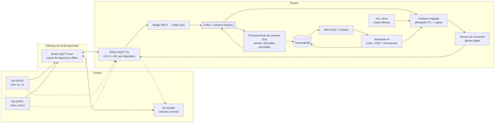
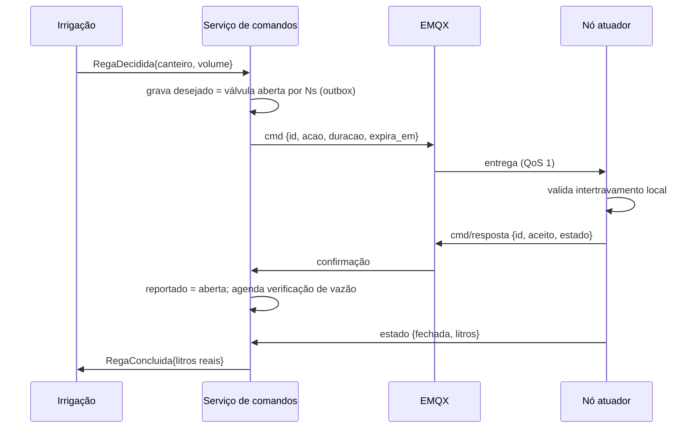

# Design Doc — Plataforma IoT de Cuidado de Plantas e Hortas

- id: garden-iot (projeto próprio, ao lado do kafka-telemetry; pode reaproveitar padrões dele, como schemas versionados e garantias de entrega)
- Status: Proposto
- Arquitetura: Clean Architecture + Hexagonal + DDD, Anti-Corruption Layer em dispositivos e APIs externas, edge + cloud orientado a eventos

## 1. Problema

Hortas domésticas e pequenos produtores irrigam no "olhômetro": regam demais ou de menos, ignoram vento forte ou chuva prevista e só percebem uma praga quando já se espalhou. Sensores baratos (umidade do solo, nível de água, vento, luz, temperatura) existem, mas os dados raramente viram decisões automáticas e seguras.

A plataforma:

- coleta telemetria de nós sensores em campo;
- calcula a necessidade hídrica de cada canteiro com um modelo agronômico conhecido;
- aciona atuadores (válvulas, bomba) com regras de segurança e confirmação do dispositivo;
- alerta e orienta com IA (diagnóstico por foto, explicações), sempre com humano no controle das ações físicas fora da política.

## 2. Objetivos e não-objetivos

Objetivos

- Nós ESP32 com sensores de umidade do solo, nível e vazão de água, chuva, vento (velocidade e direção), luz, temperatura e umidade do ar.
- Comandos para válvulas solenoides e bomba, com estado desejado vs. reportado (gêmeo digital).
- Pipeline MQTT → Kafka com schemas versionados, agregações em janela e detecção de anomalias.
- Irrigação calculada por evapotranspiração (FAO-56) ajustada por cultura, estágio, chuva e previsão do tempo.
- Assistente com IA: foto da folha → suspeita de praga ou doença; explicações e plano de cuidado com RAG.
- Tudo simulável sem hardware (Wokwi + simulador de frota).

Não-objetivos

- Automação de estufas comerciais de grande porte (clima, CO₂, fertirrigação completa).
- Venda ou gestão comercial da produção.
- Recomendação de defensivos químicos ou dosagens: o assistente só indica suspeita e manejo geral, e orienta procurar um agrônomo.

## 3. Arquitetura

### 3.1 Visão geral



### 3.2 Contextos delimitados

| Contexto | Responsabilidade | Agregados | Eventos |
| --- | --- | --- | --- |
| Dispositivos | Provisionamento, certificados, firmware, saúde do nó | Dispositivo, VersaoFirmware | DispositivoProvisionado, DispositivoOffline, FirmwareAtualizado |
| Telemetria | Leituras brutas, validação, calibração, agregação | Sensor, Calibracao | LeituraRegistrada, LeituraRejeitada, AnomaliaDetectada |
| Cultivo | Hortas, canteiros, culturas e estágios | Horta, Canteiro, Cultura, EstagioFenologico | CanteiroPlantado, EstagioAlterado |
| Irrigação | Necessidade hídrica, programação, decisão de regar | ProgramaDeIrrigacao, DecisaoDeRega | RegaDecidida, RegaAdiada, RegaConcluida |
| Comandos | Envio a atuadores com confirmação e timeout | Comando, GemeoDigital | ComandoEnviado, ComandoConfirmado, ComandoExpirou |
| Alertas | Regras de alerta e canais de notificação | RegraDeAlerta, Alerta | AlertaDisparado, AlertaReconhecido |

### 3.3 Anti-Corruption Layer

| Fronteira | Tradutor | Detalhe |
| --- | --- | --- |
| Payload dos nós (por versão de firmware) | DevicePayloadTranslator | Converte leituras brutas (ADC, pulsos, lux) em grandezas de domínio (umidade volumétrica %, L/min, m/s, W/m²) usando a calibração do sensor; payload de firmware antigo continua aceito |
| API de clima (Open-Meteo) | WeatherTranslator | Previsão de chuva, vento e radiação → PrevisaoLocal do domínio |
| Modelo de visão (detecção) | VisionTranslator | Rótulos e confiança do modelo → Suspeita com nível de confiança e manejo associado |

## 4. Edge: firmware e hardware

### 4.1 Nó sensor (ESP32, ESP-IDF em C)

| Grandeza | Sensor de referência | Interface | Observação |
| --- | --- | --- | --- |
| Umidade do solo | Capacitivo (não resistivo, que corrói) | ADC | Calibração seco/saturado por canteiro |
| Temperatura e umidade do ar | SHT31 ou BME280 | I²C | Base do VPD e da ET₀ |
| Luz | BH1750 | I²C | lux → radiação aproximada (ver 6.3) |
| Vento | Anemômetro de conchas + biruta | Pulsos (contador) + ADC | Ajuste para 2 m de altura (FAO-56) |
| Chuva | Pluviômetro de báscula | Interrupção por pulso | mm por pulso calibrado |
| Nível e vazão de água | Sensor de nível (boia ou ultrassônico) + medidor de vazão por pulsos | GPIO | Detecta reservatório vazio e vazamento |

Firmware

- Ciclo: acorda, lê, publica em lote, volta ao deep sleep (nós a bateria); nó atuador fica sempre ligado.
- Buffer local em flash quando offline; reenvio com timestamp original (servidor aceita fora de ordem).
- Timestamp por SNTP; sequência monotônica por nó para deduplicar.
- OTA com imagem assinada e rollback automático se o novo firmware não reportar saúde em N minutos.
- Watchdog e reinício seguro.

### 4.2 Nó atuador

- Relés ou MOSFET para válvulas solenoides 12 V e bomba; válvula normalmente fechada.
- Intertravamento local (no firmware, independe da nuvem): tempo máximo de válvula aberta; bomba nunca liga com reservatório vazio; fecha tudo se perder conexão por mais de X minutos durante uma rega.
- Reporta estado real (aberta/fechada, vazão medida) para confirmar o comando.

### 4.3 Simulação sem hardware

- Wokwi simula ESP32 com Wi-Fi e MQTT; o wokwi-cli roda no CI e valida a saída serial (--expect-text), permitindo testes de regressão do firmware sem placa.
- Simulador de frota (Go): gera telemetria de N nós com perfis (dia ensolarado, chuva, vento forte, sensor travado, nó que cai), para testes de carga e de regras.

## 5. Mensageria

### 5.1 MQTT 5 (EMQX)

```text
horta/{tenant}/{horta}/{no}/telemetria        # QoS 1, lote de leituras
horta/{tenant}/{horta}/{no}/estado            # retained, estado reportado do nó
horta/{tenant}/{horta}/{no}/cmd               # QoS 1, comando para atuador
horta/{tenant}/{horta}/{no}/cmd/resposta      # confirmação do comando
horta/{tenant}/{horta}/{no}/lwt               # Last Will: nó offline
```

- mTLS por dispositivo: certificado individual emitido no provisionamento (CA própria no Vault).
- ACL do broker por dispositivo: cada nó só publica nos seus tópicos e só assina o seu cmd; serviços têm credenciais próprias com escopo mínimo.
- Request/response do MQTT 5: Correlation Data com o id do comando e Response Topic; expiração da mensagem (Message Expiry Interval) para comando não ser executado atrasado.

### 5.2 Kafka

| Tópico | Chave | Conteúdo | Retenção |
| --- | --- | --- | --- |
| telemetria.bruta.v1 | no_id | Leitura bruta + metadados de firmware | 7 dias |
| telemetria.normalizada.v1 | canteiro_id | Leitura em grandezas de domínio | 30 dias |
| telemetria.agregada.1m.v1 | canteiro_id | Agregados de 1 minuto | 90 dias |
| irrigacao.decisoes.v1 | canteiro_id | Decisões de rega e motivos | compactado |
| comandos.v1 | no_id | Comandos e confirmações | 30 dias |
| dlq.* | — | Mensagens inválidas | 14 dias |

- Schema Registry com Protobuf; compatibilidade BACKWARD; contratos versionados no repositório.
- Bridge MQTT → Kafka em Go: produtor idempotente, deduplicação por (no_id, sequencia), mensagens inválidas para DLQ com motivo.
- Processamento de streams (Go): janelas de 1 min e 1 h, derivadas (VPD, ET₀ horária, luz acumulada), detecção de anomalia (EWMA + z-score por sensor; "sensor travado" quando a variância fica zero por horas).

## 6. Modelo agronômico

### 6.1 Evapotranspiração de referência (FAO-56, Penman-Monteith)

ET₀ = [0,408 Δ (Rₙ − G) + γ (900 / (T + 273)) u₂ (eₛ − eₐ)] / [Δ + γ (1 + 0,34 u₂)]

- T: temperatura média do ar (°C); u₂: vento a 2 m (m/s); eₛ − eₐ: déficit de pressão de vapor (kPa); Rₙ: radiação líquida; G: fluxo de calor do solo (≈ 0 no cálculo diário); Δ e γ: inclinação da curva de pressão de vapor e constante psicrométrica.
- Vento medido a outra altura z: u₂ = u_z × 4,87 / ln(67,8 z − 5,42).
- eₛ = 0,6108 × exp(17,27 T / (T + 237,3)); eₐ = eₛ × UR / 100.

### 6.2 Necessidade da cultura e decisão de rega

- ETc = Kc × ET₀, com Kc por cultura e estágio fenológico (tabela da FAO, editável).
- Balanço hídrico do canteiro: déficit acumulado = déficit anterior + ETc − chuva efetiva − irrigação aplicada.
- Gatilho: regar quando o déficit passa do limite de água facilmente disponível da cultura ou quando a umidade do solo medida cai abaixo do limite calibrado. A medida do sensor corrige o modelo (fusão simples: o sensor tem prioridade quando está saudável; modelo assume se o sensor estiver anômalo).

### 6.3 Luz

- DLI (luz diária) = PPFD (µmol/m²/s) × segundos de luz / 10⁶.
- Conversão lux → PPFD é aproximada e depende da fonte de luz (para sol, ordem de grandeza de 0,0185 × lux). Tratar como estimativa, com flag de qualidade no dado.

### 6.4 Regras de segurança da irrigação (domínio)

| Regra | Efeito |
| --- | --- |
| Vento acima do limite (ex.: 5 m/s) e irrigação por aspersão | Adia a rega (deriva e perda) |
| Chuva prevista ≥ X mm nas próximas Y horas | Reduz ou adia |
| Temperatura < 2 °C | Não rega; dispara alerta de geada |
| Reservatório abaixo do mínimo | Bloqueia bomba; alerta |
| Vazão medida ≠ esperada (± 30%) durante a rega | Fecha válvula; alerta de vazamento ou entupimento |
| Comando sem confirmação em T segundos | ComandoExpirou; nova tentativa limitada; depois alerta |
| Regas manuais | Permitidas, mas também passam pelas regras de segurança |

## 7. Comandos e gêmeo digital



- Idempotência no nó: comando com id já executado é ignorado e reconfirmado.
- Saga da rega: abrir válvula → confirmar vazão → fechar por tempo ou volume → registrar; qualquer falha leva a uma ação compensatória (fechar tudo) e a um alerta.

## 8. Assistente com IA

- Visão: foto da folha → modelo de detecção (YOLO exportado para ONNX ou TensorFlow.js) → suspeitas com confiança. Treino com dataset público de doenças de plantas; avaliação por precisão e recall por classe.
- RAG: base de conhecimento de cultivo (guias públicos de hortaliças) com embeddings; respostas sempre com a fonte citada.
- Agente (LangGraph) com ferramentas MCP: get_garden_status, get_sensor_history, get_irrigation_plan, explain_decision, propose_irrigation_change.
- Limites de autonomia:
  - o agente nunca aciona atuador diretamente; propose_irrigation_change gera uma proposta que passa pelas regras de segurança e exige aprovação do dono da horta (approval gate);
  - não recomenda produtos químicos nem dosagens;
  - suspeita com baixa confiança é apresentada como incerta, com orientação de procurar um agrônomo.
- Alertas: push no app e e-mail; WhatsApp opcional usando mensagens de template do projeto 8 (notificação de negócio, dentro da política da Meta).

## 9. Segurança

- Dispositivo: secure boot e criptografia de flash quando disponíveis no chip, mTLS, OTA assinado, sem credenciais em texto no firmware.
- Broker: ACL por dispositivo e por serviço; nada anônimo.
- Multitenant: tenant em todos os tópicos, chaves e tabelas; isolamento verificado por testes.
- Comandos físicos: autorização por papel (dono, operador, leitor); trilha de auditoria de todo comando.

## 10. Observabilidade e SLOs

- Métricas: nós online, atraso ponta a ponta (sensor → TimescaleDB), lag dos consumidores Kafka, comandos confirmados vs. expirados, regas adiadas por regra.
- SLOs: 99% das leituras disponíveis em menos de 10 s após a publicação; 99,5% dos comandos confirmados em menos de 5 s com o nó online.
- Grafana para operação; tela própria (Vue) para o usuário final.

## 11. Testes

| Tipo | O quê |
| --- | --- |
| Unidade (domínio) | ET₀ com valores de referência do exemplo da FAO-56; balanço hídrico; regras de segurança |
| Firmware | Wokwi no CI com --expect-text; testes unitários de conversão e intertravamento |
| Contrato | Schemas Protobuf com compatibilidade verificada no CI; tradutores da ACL por versão de firmware |
| Integração | Testcontainers (Kafka, EMQX, TimescaleDB) |
| Carga | Simulador de frota com 1.000 nós a 1 leitura/min; medir lag e atraso |
| Caos | Nó cai no meio da rega, mensagens duplicadas e fora de ordem, broker reinicia, previsão do tempo indisponível |
| Visão e RAG | Precisão/recall por classe; evals de respostas com fonte obrigatória e recusa de recomendação química |

## 12. Plano de entrega

- M1 Telemetria simulada: firmware no Wokwi, EMQX com mTLS e ACL, bridge para Kafka, TimescaleDB, painel Grafana.
- M2 Streams: schemas, agregações, derivadas (VPD, ET₀), anomalias, DLQ.
- M3 Irrigação: contexto Cultivo, balanço hídrico, regras de segurança, previsão do tempo pela ACL.
- M4 Comandos: nó atuador, gêmeo digital, saga da rega, intertravamentos.
- M5 IA: modelo de visão, RAG, agente com approval gate, evals.
- M6 Produção: Kubernetes + Helm + ArgoCD, OTA assinado, testes de carga e caos, hardware real num canteiro.

## 13. ADRs iniciais

| ADR | Decisão |
| --- | --- |
| G-01 | MQTT 5 na borda e Kafka no backend, ligados por bridge própria em Go |
| G-02 | Protobuf + Schema Registry com compatibilidade BACKWARD |
| G-03 | Estado desejado vs. reportado (gêmeo digital) para todo atuador |
| G-04 | Intertravamentos de segurança no firmware, independentes da nuvem |
| G-05 | Irrigação por FAO-56 corrigida pelo sensor de umidade |
| G-06 | Agente de IA sem acesso direto a atuadores; propostas com aprovação |
| G-07 | ACL por versão de firmware para payloads de dispositivo |
| G-08 | Wokwi + simulador de frota como ambiente padrão de desenvolvimento |

## 14. Modo par (núcleo seu)

- Cálculo de ET₀ e balanço hídrico (seção 6).
- Regras de segurança da irrigação e intertravamento do firmware.
- Saga da rega e gêmeo digital.

## 15. Riscos

| Risco | Mitigação |
| --- | --- |
| Sensores baratos com leitura instável | Calibração por canteiro, detecção de anomalia, fallback para o modelo |
| Comando executado atrasado ou duplicado | Expiração no MQTT 5, idempotência no nó, confirmação obrigatória |
| Válvula presa aberta | Medidor de vazão, fechamento por tempo no firmware, alerta |
| Diagnóstico de praga errado | Mostrar confiança, nunca recomendar químicos, orientar agrônomo |
| Complexidade de hardware atrasar o projeto | Wokwi e simulador primeiro; hardware real só no M6 |

## 16. Cursos que o projeto exercita (courses.yaml)

fc4-msg-kafka, fc4-ddd-events, fc4-tests-advanced, fc4-tests-testcontainers, fc4-k8s, fc4-helm, fc4-gitops, fc4-sec-owasp-vault, fc4-sec-authz, fc4-containers-deep, fc4-sql-postgres, fc4-arch-multitenant, un-1.4, un-10.1, un-10.2, un-10.3, un-6.lab04, un-6.lab05, un-6.lab06, un-6.lab11, un-8.m3, un-8.m4, lt-tech-metrics, lt-devops-sre
