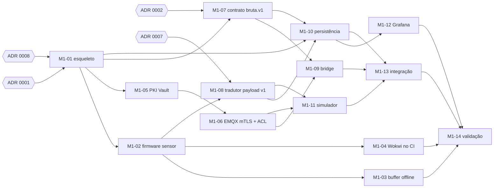

# garden-iot · M1 Telemetria simulada: ordem de execução

**Escopo (design doc, seção 12):** firmware no Wokwi, EMQX com mTLS e ACL, bridge para Kafka, TimescaleDB, painel Grafana.

**Critério de pronto proposto** (o design doc não traz um explícito; precisa de aprovação): o firmware roda no Wokwi com o job de CI verde; nós simulados publicam por mTLS e a ACL nega tópicos de outro nó e de outro tenant; as leituras passam pela bridge, chegam ao Kafka, ao TimescaleDB e ao painel Grafana; 99% das leituras ficam disponíveis em menos de 10 s (M1-13, M1-14).

O garden-iot é um projeto próprio, ao lado do kafka-telemetry. Pode reaproveitar padrões dele (schemas versionados, garantias de entrega), mas nenhuma issue depende dele nem migra nada dele.

## ADRs que o M1 usa (status Proposto)

| ADR | Decisão | Bloqueia |
| --- | --- | --- |
| [0001](../adr/0001-mqtt5-na-borda-kafka-no-backend.md) (G-01) | MQTT 5 na borda, Kafka no backend, bridge própria em Go | M1-01, M1-09 |
| [0002](../adr/0002-protobuf-schema-registry-backward.md) (G-02) | Protobuf + Schema Registry BACKWARD | M1-07 |
| [0007](../adr/0007-acl-por-versao-de-firmware.md) (G-07) | ACL por versão de firmware | M1-08 |
| [0008](../adr/0008-wokwi-e-simulador-de-frota.md) (G-08) | Wokwi + simulador de frota como ambiente padrão | M1-01, M1-04, M1-11 |

## Issues

| Id | Título | core | curso | Depende de | Estimativa |
| --- | --- | --- | --- | --- | --- |
| [M1-01](M1-01-esqueleto-e-ambiente-local.md) | Esqueleto do repositório e ambiente local | false | fc4-containers-deep | ADRs 0001, 0008 | 1 dia |
| [M1-02](M1-02-firmware-no-sensor.md) | Firmware do nó sensor: leitura, lote e publicação MQTT | false | — | M1-01 | 1 dia |
| [M1-03](M1-03-firmware-buffer-offline-e-robustez.md) | Firmware: buffer offline, deep sleep e watchdog | false | — | M1-02 | 1 dia |
| [M1-04](M1-04-wokwi-no-ci.md) | Wokwi no CI e testes unitários do firmware | false | lt-devops-sre | M1-02 | ½ dia |
| [M1-05](M1-05-pki-de-dispositivos-vault.md) | PKI de dispositivos no Vault e provisionamento | false | fc4-sec-owasp-vault | M1-01 | 1 dia |
| [M1-06](M1-06-emqx-mtls-e-acl.md) | EMQX com mTLS e ACL por dispositivo e por serviço | false | fc4-sec-authz | M1-05 | 1 dia |
| [M1-07](M1-07-contrato-telemetria-bruta-v1.md) | Contrato Protobuf `telemetria.bruta.v1` | false | fc4-msg-kafka | M1-01, ADR 0002 | ½ dia |
| [M1-08](M1-08-device-payload-translator-v1.md) | `DevicePayloadTranslator` v1 | false | fc4-arch-hexagonal | M1-02, ADR 0007 | 1 dia |
| [M1-09](M1-09-bridge-mqtt-kafka.md) | Bridge MQTT → Kafka em Go | false | fc4-msg-kafka | M1-06, M1-07 | 1 dia |
| [M1-10](M1-10-persistencia-timescaledb.md) | Persistência da telemetria no TimescaleDB | false | fc4-sql-postgres | M1-01, M1-07, M1-08 | 1 dia |
| [M1-11](M1-11-simulador-de-frota.md) | Simulador de frota, versão inicial | false | fc4-tests-advanced | M1-06, M1-08 | 1 dia |
| [M1-12](M1-12-painel-grafana.md) | Painel Grafana provisionado | false | lt-tech-metrics | M1-10 | ½ dia |
| [M1-13](M1-13-integracao-ponta-a-ponta.md) | Integração ponta a ponta com Testcontainers | false | fc4-tests-testcontainers | M1-09, M1-10, M1-11 | 1 dia |
| [M1-14](M1-14-validacao-m1.md) | Validação do critério de pronto | false | — | M1-03, M1-04, M1-12, M1-13 | ½ dia |

Firmware em C não tem curso correspondente no `courses.yaml`; M1-02 e M1-03 ficam com `curso: —`.

## O que é core e o que não é

O núcleo do autor neste projeto (`plan.yaml`: `et0-e-balanco-hidrico`, `regras-de-seguranca-e-intertravamento`, `saga-da-rega`; seção 14 do design doc) cai no M2 a M4: o intertravamento é do nó atuador, que entra no M4. **Nenhuma issue do M1 é core**: o agente implementa todas. O modo par continua ligado no projeto.

## Ordem e paralelismo

1. **Onda 0 (autor):** revisar e aceitar os ADRs 0001, 0002, 0007 e 0008, e responder aos pontos em aberto.
2. **Onda 1:** M1-01.
3. **Onda 2, em paralelo:** M1-02, M1-05, M1-07.
4. **Onda 3, em paralelo:** M1-03, M1-04, M1-06, M1-08.
5. **Onda 4, em paralelo:** M1-09, M1-10, M1-11.
6. **Onda 5, em paralelo:** M1-12, M1-13.
7. **Onda 6:** M1-14.

Caminho crítico: M1-01 → M1-05 → M1-06 → M1-09 (ou M1-11) → M1-13 → M1-14, cerca de 5,5 dias.

## Fora do M1 (não quebrar)

- Demais schemas, `telemetria.normalizada.v1`, agregações, derivadas (VPD, ET₀), anomalias e DLQ: M2.
- Contexto Cultivo (canteiros, calibração por canteiro), balanço hídrico, regras de segurança e clima: M3.
- Nó atuador, comandos, gêmeo digital, saga da rega e intertravamentos: M4.
- Visão, RAG e agente: M5.
- Kubernetes, OTA assinado, carga com 1.000 nós, caos e hardware real: M6.

## Pontos em aberto para o autor

1. Formato do payload MQTT do firmware (JSON, CBOR, Protobuf em C?). M1-02 propõe um formato versionado simples.
2. O plano põe "schemas" e "DLQ" no M2, mas a bridge do M1 precisa de contrato e de destino para inválidas. As issues antecipam só `telemetria.bruta.v1` (M1-07) e descartam inválidas com log e métrica (M1-09).
3. Onde roda o `DevicePayloadTranslator` (M1-08 propõe pacote reutilizável, usado pela persistência no M1 e pelos streams no M2) e de onde vem a calibração antes do contexto Cultivo.
4. O firmware simulado no Wokwi precisa alcançar o EMQX local para um teste ponta a ponta com o firmware real (não só com o simulador de frota)? Isso pode exigir o gateway de rede do Wokwi.
5. Sensores de vento, chuva, nível e vazão: entram no M1 ou ficam para quando houver nó de vento e chuva?
6. Identidade no certificado (CN/SAN), checagem de revogação (CRL/OCSP) e isolamento por tenant no banco (M1-10 propõe RLS).

## Decisões do autor

- (pendente) Aprovar as issues e aceitar os ADRs.
- 2026-11-21: o garden-iot não substitui o kafka-telemetry; os dois existem lado a lado. O garden-iot pode reaproveitar padrões dele (schemas versionados, garantias de entrega).
